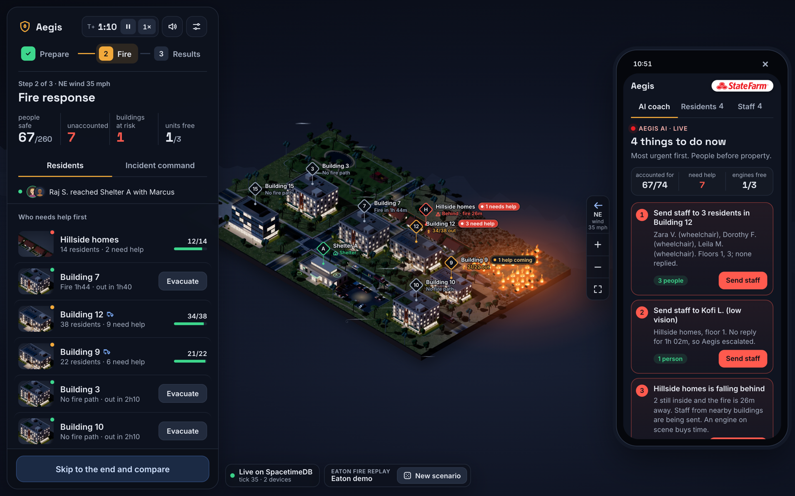
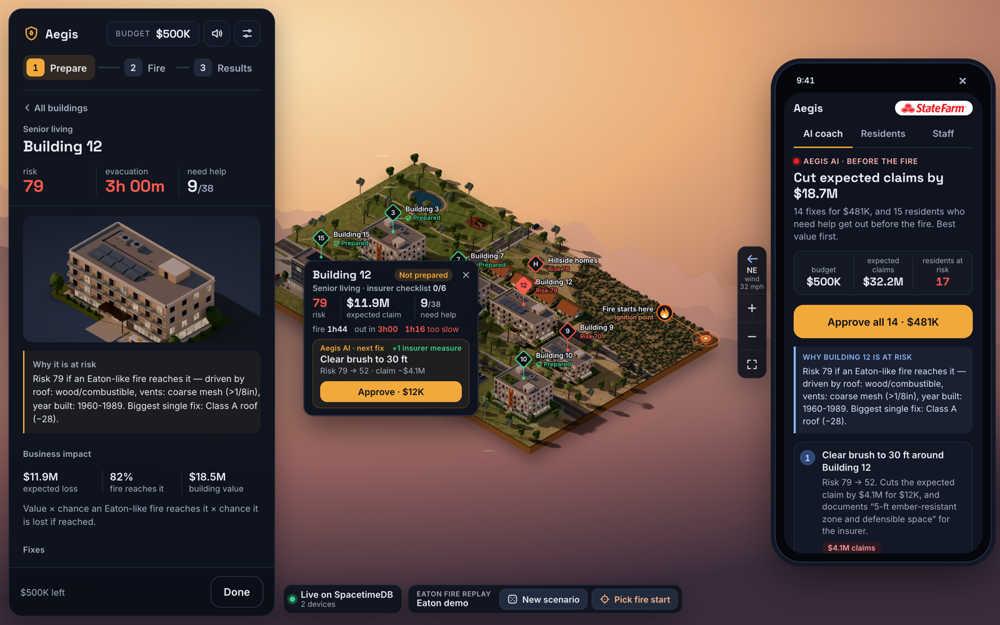
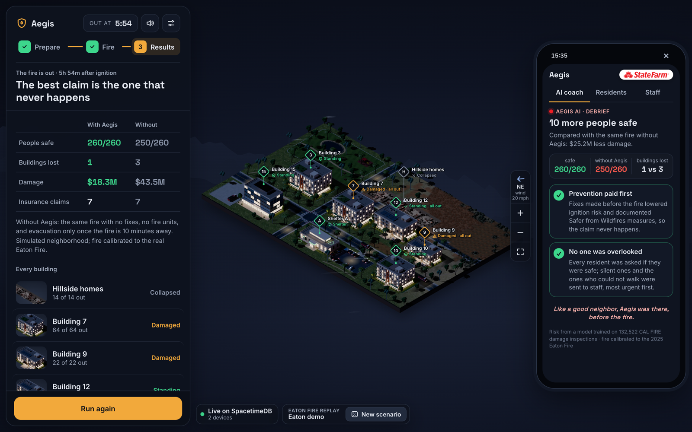
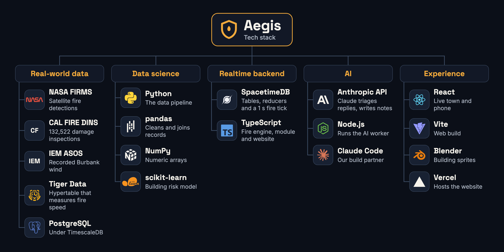

<p align="center">
  
</p>

<h1 align="center">🛡️ Aegis</h1>
<p align="center"><b>Prepare buildings. Save every resident.</b><br/>
An AI wildfire coach for property managers and the insurers behind them.</p>

<p align="center">
  🎬 <a href="https://youtu.be/lORYwjN39mg"><b>Watch the demo</b></a> ·
  🔗 <a href="https://aegis-beta-nine.vercel.app"><b>Try it live</b></a> ·
  🏆 HackUTD 2026 · State Farm · CBRE · SpacetimeDB
</p>

<p align="center">
  <a href="https://youtu.be/lORYwjN39mg">
    
  </a>
</p>

## 🔥 Why

In January 2025 the Eaton Fire tore through Altadena. Nearly 20 people died, most in the area where evacuation alerts arrived hours after the fire. CAL FIRE inspected 18,428 structures afterward and found 9,419 destroyed, about half. The problem wasn't the forecast. It was knowing, building by building, **what to fix before the fire, and who needs help first when it comes.**

## 🛡️ What it does

Aegis runs a live, shared simulation of a neighborhood hit by an Eaton-like fire, and coaches the person responsible for the buildings through it.

| | |
|---|---|
| 🧰 **Before the fire** | A model trained on real CAL FIRE damage inspections scores every building and turns it into an expected insurance claim. The AI coach ranks fixes (residents who need help first, then claims avoided per dollar), and one tap approves the plan. Each fix is documented against California's *Safer from Wildfires* checklist. |
| 🚨 **During the fire** | Every resident gets a check-in. Claude reads free-text replies in any language ("my oxygen is almost empty" → urgent task). The coach says what to do now: send staff, evacuate this building before the fire arrives, send an engine ahead of it. Every building shows live alerts, and staff get a task board. |
| 📈 **After the fire** | The same fire, replayed without Aegis. On the demo map: **260/260 safe vs 250/260, 1 fewer building lost, ~$24M less damage.** Over 40 fires: 6.2 more people safe, $15.0M less damage on average. |
| 🎲 **Not scripted** | **New scenario** generates new wind, fire start, construction and residents in a fraction of a second; the model re-scores every building and the coach re-plans. You can also click anywhere on the map to start the fire. |



<p>
  
  
</p>

## 🧠 How it works

- **Risk model.** Logistic regression on **35,062** structures from **41** fires in CAL FIRE's damage inspection data (DINS, 132,522 records), with fire × neighborhood fixed effects. **0.944 AUC** on held-out homes (0.665 on unseen fires with construction alone), recalibrated to Eaton's 49.7% destruction rate. It explains *why*: roof, vents, eaves, siding, windows, age.
- **Expected claim** = building value × P(fire reaches it) × P(destroyed | reached).
- **Fire.** A cellular-automaton fire with ember spotting, calibrated to the Eaton Fire's real front speed (1.92 km/h from NASA FIRMS satellite detections) with the recorded Burbank wind, over 1,000 simulated fires. Monte Carlo forecasts give each building's arrival time and reach chance.
- **A fair comparison.** "With" and "without Aegis" burn the *same* fire: every spread link and building has one random threshold for the whole fire, so a fix, a lower risk or an engine on scene can only delay or prevent a burn. Across 40 random worlds, Aegis's plan never lost more buildings or people. Damage was lower in 18, the same in 21 and higher in 1.
- **AI where rules break down.** Claude (Anthropic API, structured outputs) triages residents' free text and writes plain-language building instructions. It never produces numbers; every time and dollar figure comes from the model and the simulation.

## ⚡ Architecture

```
 browser (React + Vite, Vercel) ──┐
 phones / dashboards (any number) ┼──▶  SpacetimeDB module (Maincloud)
 AI worker (Node + Claude) ───────┘     tables + reducers + 1 s scheduled fire tick
                                          ▲
 data pipeline (Python) ── Tiger Data ────┘  seed: risk model, fire calibration, neighborhood
```

- **SpacetimeDB** is the whole backend: the world lives in tables, and every action is a transactional reducer (approve a fix, evacuate, claim a rescue atomically, dispatch an engine, generate a scenario). A scheduled reducer advances the fire every second; every client subscribes and stays in sync.
- **Tiger Data** (TimescaleDB) holds the NASA FIRMS detections as a hypertable; a `time_bucket` query measures Eaton's real spread speed for calibration.

## 🧱 Built with



TypeScript · React 19 · Vite · SpacetimeDB (Maincloud) · Node.js · Claude (Anthropic API) · Python · pandas · scikit-learn · Tiger Data / TimescaleDB · Blender · Vercel · NASA FIRMS · CAL FIRE DINS · IEM ASOS

## 📁 Repository

| Path | What |
|---|---|
| [`spacetimedb/`](spacetimedb/) | The module: schema, reducers, fire and evacuation engine ([`SIM.md`](spacetimedb/SIM.md)), random scenarios, fire engines, insurer checklist, bundled risk model |
| [`web/`](web/) | The website: isometric town, AI coach phone, building cards, alerts |
| [`worker/`](worker/) | AI worker (Claude): reply triage and building notes |
| [`data/`](data/) | Pipeline: FIRMS / wind / DINS downloads, risk model, calibration, seed ([`README`](data/README.md)) |
| [`docs/backend.md`](docs/backend.md) | Reducers, tables, subscriptions and rules |
| [`deploy/`](deploy/README.md) | Hosting (Vercel + Maincloud) |
| [`blender/`](blender/), [`preview/`](preview/) | Sprite renders; the engine in a browser with no server |

## 🚀 Run it locally

Requires Node 22+ and the [SpacetimeDB CLI](https://spacetimedb.com/install).

```bash
npm install && npm --prefix web install
spacetime start                    # local server on 127.0.0.1:3000 (leave it running)
npm run publish:local              # publish the module; it loads the Eaton demo map
npm run web:dev                    # open http://127.0.0.1:5173
```

Optional AI worker: `cd worker && npm install && cp .env.example .env` (set `ANTHROPIC_API_KEY`), then `npm start` and `npm run register` once.

**Tests:** `npm test` (engine, scenarios, engines, insurer checklist) · `npm run check` (types) · `npm run smoke` (full integration against a disposable database) · `npm --prefix worker test`.

## ⚠️ What's real and what's simulated

The neighborhood, residents and dollar values are **fictional**. The fire is calibrated to the real 2025 Eaton Fire, and building risk comes from a model trained on real CAL FIRE inspections. Aegis is a hackathon prototype, not an emergency service.

---

<p align="center">Built at <b>HackUTD 2026</b> 🤠 · Like a good neighbor, Aegis was there, before the fire.</p>
